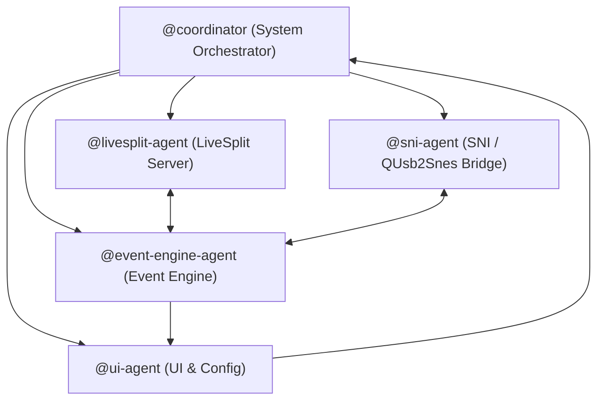

# System Architecture & Coordinator Skill (`@coordinator`)

This skill defines the technical standards, concurrency patterns, and architectural invariants for GotoSplitter's central orchestrator, owned by `@coordinator`.

---

## 1. Role & Architectural Boundaries

- **Owning Agent:** `@coordinator`
- **Primary Packages:** `main.go`, `config/`, system lifecycle, concurrency channels
- **Core Mission:** Maintain high-level architecture, thread safety, and event loop synchronization between the LiveSplit server, SNI client, event engine, and UI.



---

## 2. Core Responsibilities

1. **Unified Go Interfaces & Message Pipelines**:
   - Define clean Go interfaces between subsystems (`LiveSplitServer`, `SNIClient`, `EventEvaluator`, `UIApp`).
   - Route messages and state events across typed Go channels rather than direct coupling.

2. **Strict Package Isolation (No Circular Dependencies)**:
   > [!IMPORTANT]
   > Direct package-to-package circular dependencies (e.g. `sni` importing `livesplit` or vice versa) are **strictly forbidden**.
   > All cross-system coordination flows through typed channels, callback hooks, or orchestrator interfaces.

3. **Non-Blocking Polling Loops & Goroutine Lifecycle**:
   - Polling loops must be managed via `context.Context` and `time.Ticker`.
   - Never allow tight spinning loops (`for {}` without sleep or ticker) that consume 100% CPU.
   - When SNI or LiveSplit is disconnected, back off gracefully.

4. **Thread Safety & State Management**:
   - Protect shared mutable state with `sync.RWMutex` or `sync/atomic`.
   - Ensure channel sends never block the main loop indefinitely (use buffered channels or non-blocking `select` where appropriate).

5. **Graceful Startup & Shutdown Sequences**:
   - Intercept OS signals (`SIGINT`, `SIGTERM`).
   - Cancel root `context.Context` to propagate teardown to all child goroutines.
   - Close sockets, release resources, and save pending configuration.

---

## 3. Subsystem Interaction Contracts

### Channel-Based Pipelines

| Channel | Producer | Consumer | Purpose |
| :--- | :--- | :--- | :--- |
| `chan engine.SplitAction` | Event Engine | Coordinator / LiveSplit | Transmits `"start"`, `"split"`, `"reset"` actions |
| `chan sni.Status` | SNI Client | Coordinator / UI | Connection state (`Disconnected`, `Connecting`, `Attached`) |
| `chan livesplit.Status` | LiveSplit Server | Coordinator / UI | Client count and connection state |
| `chan engine.TrackingState` | Event Engine | UI | Selected game definition and target split name |
| `chan config.Config` | UI | Coordinator | Runtime config updates (files, addresses) |

Game-definition configuration uses `GameDefinitionFolder` and `CurrentGameDefinition`. The folder defaults to the directory containing `config.json`; the current value is a filename in that folder. If it is empty, select the first alphabetically sorted `.json` file. Startup must fail if there is no viable definition, reporting the error in the UI and terminal. Applying a UI selection loads it and resets run tracking.

The LiveSplit One protocol provides timer state and segment names, but not game/category metadata. Keep the selected game definition explicit. When a timer reset is requested, ask the UI for an explicit Save/Discard choice; Cancel must not dispatch the reset or clear coordinator state.

---

## 4. Step-by-Step Implementation Runbook

1. **Bootstrap Configuration & Context**:
   - Load initial config from `config/config.go` (`config.Load()`).
   - Create cancellable root context:
     ```go
     ctx, stop := signal.NotifyContext(context.Background(), os.Interrupt, syscall.SIGTERM)
     defer stop()
     ```
2. **Instantiate Subsystems**:
   - Initialize `livesplit.Server(cfg.LiveSplitAddress)`
   - Initialize `sni.Client(cfg.SNIAddress)`
   - Initialize `engine.NewEngine(cfg)`
   - Initialize `ui.NewApp(cfg)` (or headless runner if no display)
3. **Connect Event Pipelines**:
   - Wire engine action output to LiveSplit server `DispatchAction`.
   - Wire status callbacks to UI state binders.
4. **Launch Main Event Loop**:
   - Run subsystems in managed goroutines with error groups or wait groups.
5. **Handle Teardown**:
   - Wait for `ctx.Done()`, stop tickers, close connections cleanly, save configuration.

---

## 5. Verification & Validation Checklist

- [ ] Project compiles with zero warnings: `go build -v ./...`.
- [ ] No circular imports exist between packages (`go vet ./...`).
- [ ] Program shuts down cleanly within 1 second on Ctrl+C (`SIGINT`).
- [ ] CPU usage remains near 0% when idle or waiting for connections.
- [ ] Concurrency safety verified: `go test -race ./...`.
