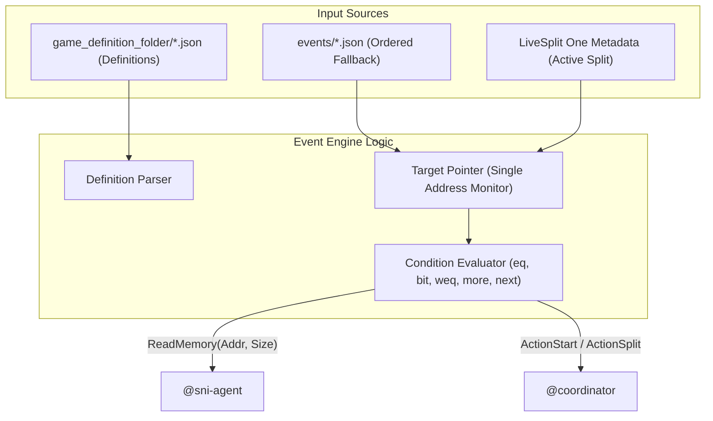

# Definition Parser & Event Engine Skill (`@event-engine-agent`)

This skill defines the technical standards, condition evaluation logic, sequential queue processing, and single-address polling optimization for the **Event Engine** component of GotoSplitter, owned by `@event-engine-agent`.

---

## 1. Role & Architectural Boundaries

- **Owning Agent:** `@event-engine-agent`
- **Primary Packages:** `engine/`, `definitions/`, `events/`
- **Key Files:** `engine/parser.go`, `engine/evaluator.go`, `engine/sequencer.go`
- **Core Mission:** Parse game definition files, manage ordered event queues, and evaluate memory conditions to determine when a split condition is met.



---

## 2. Core Responsibilities

1. **Parse `Usb2Snes-Livesplit-Definitions` JSON Schemas**:
   - Parse root fields: `name`, `autostart`, `definitions`, `alias`, `igt`.
   - Parse condition rule objects: `name`, `address`, `value`, `type`, `more`, `next`.

2. **Select the Active Game Definition**:
   - Read `game_definition_folder` and `current_game_definition` from application config.
   - The folder defaults to `$HOME/.config/gotosplitter/`; the selected value is a filename within that folder.
   - If the filename is empty, use the first `.json` filename alphabetically (non-recursively). Startup must fail if no viable definition can be resolved or parsed.
   - Report startup definition errors in both the UI and terminal, then exit with a failure status.

3. **Active Split Tracking Strategies**:
   - **Path A (Dynamic Split Name Matching)**:
     - When LiveSplit One provides the active split name (e.g. `"Yoshi's Island 1"`), look up the rule by name in the loaded game definition.
   - **Path B (Ordered Fallback Sequence via `events.json`)**:
     - When LiveSplit One does not expose the current split name, load an ordered events file (`events.json`) for the active game and category.
     - Maintain an index pointer pointing to the current step in `ordered_events`.
     - Advance the pointer sequentially upon each successful trigger.

4. **Optimized Single-Address Polling Invariant**:
   > [!IMPORTANT]
   > Do NOT poll every condition in the game definition simultaneously. Doing so causes hundreds of unnecessary WebSocket requests and saturates the SNI memory bus.
   > **Implementation Rule:** At any given tick, GotoSplitter monitors **only the memory address of the current active event** (plus concurrent sub-conditions in `more` if applicable).

5. **Condition Evaluation Engine**:
   - **`eq` (Byte Equals)**: Evaluates whether `memory[address] == expected_value`.
   - **`weq` (Word Equals)**: 16-bit little-endian comparison: `memory[address] | (memory[address+1] << 8) == expected_value`.
   - **`bit` (Bitmask Test)**: Evaluates whether `(memory[address] & expected_value) != 0`.
   - **`more` (Concurrent Conditions)**: Array of additional conditions that must ALL evaluate to true at the same tick.
   - **`next` (Sequential Multi-Step Conditions)**: Array of condition steps that must occur in chronological order before the split triggers.

6. **Address Normalization**:
   - Handles hex strings (`"0x7E0100"`, `"0xF50010"`, `"0xA0"`) and numeric values.
   - Normalizes addresses to `uint32` using WRAM / SNES memory mapping standards.

---

## 3. Specification & Rule Evaluation Logic

See complete schema specification in [references/definition_schema.md](./references/definition_schema.md).
See reference evaluation code in [examples/evaluator.go](./examples/evaluator.go).

### Autostart vs Split Handling
- **Autostart:** When the run has not started (or after a reset), evaluate the `autostart` condition. If satisfied, emit `ActionStart`.
- **Split:** Once running, evaluate the active split rule. When satisfied, emit `ActionSplit` and advance the tracking pointer.
- **Reset Detection:** If a reset condition is defined or autostart condition drops back to idle, reset tracking state.

---

## 4. Step-by-Step Implementation Runbook

1. **Resolve, Load & Normalize Definition**:
   - Resolve the configured filename within `game_definition_folder`; when empty, choose the first alphabetically sorted JSON filename.
   - Stop startup with an error if no JSON file is available or the selected definition cannot be loaded and parsed.
   - Unmarshal JSON into typed `GameDefinition` struct.
   - Parse all address strings into `uint32` values.
   - Parse all value strings/hex into `uint64` values.
2. **Setup Sequencer**:
   - If using `events.json`, index all `event_name` entries to their definition rules.
   - Set current event index = `0` (or autostart).
3. **Execute Evaluation Tick**:
   ```go
   func (e *Engine) Tick(reader sni.MemoryReader) (*SplitAction, error) {
       rule := e.CurrentTargetRule()
       if rule == nil {
           return nil, nil
       }
       matched, err := e.EvaluateRule(rule, reader)
       if err != nil {
           return nil, err
       }
       if matched {
           e.AdvanceTarget()
           return &rule.Action, nil
       }
       return nil, nil
   }
   ```
4. **Evaluate Multi-Condition Types (`more` and `next`)**:
   - For `more`: read all addresses in the slice. Return true only if base rule AND all `more` conditions match.
   - For `next`: track internal step pointer `nextStepIndex`. Advance step pointer only when step matches. Split fires only when final step matches.

---

## 5. Verification & Validation Checklist

- [ ] Startup fails when no viable configured definition exists and reports the error in the UI and terminal.
- [ ] JSON definitions from `ChTPwner/Usb2Snes-Livesplit-Definitions` parse without errors.
- [ ] Bitwise tests (`bit`) correctly identify bitmask flags.
- [ ] 16-bit word comparisons (`weq`) correctly match little-endian values.
- [ ] Concurrent `more` conditions only fire when all conditions are true simultaneously.
- [ ] Sequential `next` steps trigger only in proper sequence.
- [ ] Fallback `events.json` advances through splits in order.
- [ ] Single-address polling verified: only 1 memory read per tick during normal split monitoring.
