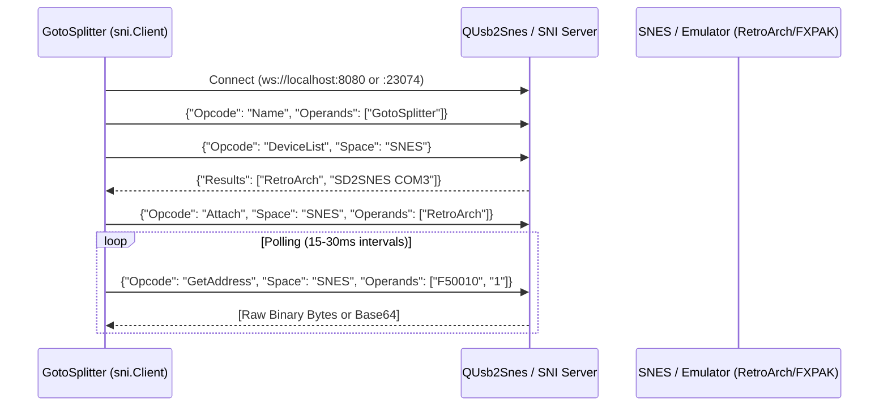

# QUsb2Snes / SNI Bridge Skill (`@sni-agent`)

This skill defines the technical standards, opcode protocol, memory mapping rules, and error handling for the **QUsb2Snes / SNI Bridge** component of GotoSplitter, owned by `@sni-agent`.

---

## 1. Role & Architectural Boundaries

- **Owning Agent:** `@sni-agent`
- **Primary Package:** `sni/`
- **Key Files:** `sni/client.go`, `sni/protocol.go`, `sni/memory.go`
- **System Role:** GotoSplitter connects as a **WebSocket Client** to the local QUsb2Snes / SNI service running on the host machine.



---

## 2. Core Responsibilities

1. **Maintain Resilient WebSocket Client Connection**:
   - Connect to `ws://localhost:8080` (SNI default) or `ws://localhost:23074` (QUsb2Snes default), configurable via `config.Config.SNIAddress`.
   - Implement exponential backoff reconnect loop (e.g. 500ms initial up to 5s max) when disconnected.
   - Handle server restarts, emulator crashes, or device unplug events gracefully.

2. **Execute JSON Opcode Lifecycle**:
   - **`Name`**: Register application name (`GotoSplitter`).
   - **`DeviceList`**: Query connected devices/emulators.
   - **`Attach`**: Attach to specified device or auto-select first available device.
   - **`GetAddress`**: Read memory buffers from `SNES` address space.

3. **Provide Clean Go Memory API**:
   ```go
   type Client interface {
       ReadMemory(address uint32, size int) ([]byte, error)
       IsConnected() bool
       CurrentDevice() string
       DeviceList() ([]string, error)
   }
   ```

4. **Rate-Limiting & Bus Protection**:
   > [!IMPORTANT]
   > Super Nintendo memory buses (especially over USB-to-SD2SNES or emulator IPC) have limited throughput.
   > **Implementation Rule:** Pace polling intervals to **15ms - 30ms** (approx. 30-60 Hz). Never flood the SNI socket with unbounded concurrent memory read requests.

5. **Binary & Base64 Payload Handling**:
   - `GetAddress` responses in standard QUsb2Snes / SNI are sent as raw binary WebSocket messages or base64 JSON fields depending on server capabilities.
   - The reader must detect frame types (`websocket.BinaryMessage` vs `websocket.TextMessage`) and decode payload bytes safely.

---

## 3. Protocol & Address Translation

See complete opcode specification in [references/protocol.md](./references/protocol.md).
See reference client implementation in [examples/client.go](./examples/client.go).

### SNES Address Spaces & WRAM Mapping
- Super Nintendo Work RAM (WRAM) is located in banks `$7E` and `$7F` (`$7E0000 - $7FFFFF`, 128 KB).
- In QUsb2Snes / SNI `SNES` memory space, WRAM is commonly addressed directly as `$F50000 - $F6FFFF` or `$7E0000 - $7FFFFF`.
- Ensure address translations convert 24-bit SNES addresses to appropriate SNI request strings:
  - `"F50000"` (hexadecimal uppercase/lowercase without `"0x"` prefix in protocol operands).
  - Size operand in hexadecimal (e.g. `"1"` or `"01"` for 1 byte, `"2"` or `"02"` for 2 bytes / 16-bit word).

---

## 4. Step-by-Step Implementation Runbook

1. **Establish Client Struct & Reconnect Loop**:
   - Use `websocket.Dialer` with a handshake timeout.
   - If connection fails or drops, notify `@coordinator` (`sni.StatusDisconnected`) and schedule backoff retry.
2. **Perform Handshake**:
   - Send `Name`: `{"Opcode": "Name", "Space": "SNES", "Operands": ["GotoSplitter"]}`.
   - Send `DeviceList`: `{"Opcode": "DeviceList", "Space": "SNES"}`.
   - Parse `"Results"` array. If devices exist, select target device or default to `results[0]`.
   - Send `Attach`: `{"Opcode": "Attach", "Space": "SNES", "Operands": [deviceName]}`.
   - Transition status to `sni.StatusAttached`.
3. **Implement ReadMemory Synchronizer**:
   - Format address and length as hex strings:
     ```go
     addrStr := fmt.Sprintf("%X", address)
     sizeStr := fmt.Sprintf("%X", size)
     ```
   - Send `GetAddress` request mutex-protected.
   - Read binary response packet matching requested length.
   - Return byte slice or descriptive error on timeout/EOF.
4. **Notify System of Status Changes**:
   - Emit state changes (`Disconnected`, `Connecting`, `Connected`, `Attached: <Device>`) to the status channel.

---

## 5. Verification & Validation Checklist

- [ ] Successfully connects to local SNI (`ws://localhost:8080`) or mock SNI server.
- [ ] Device list correctly populates available devices.
- [ ] Memory read (`ReadMemory(0x7E0010, 1)`) returns expected byte from target game.
- [ ] If SNI server is terminated while running, client does not panic and automatically reconnects when SNI is restored.
- [ ] Memory polling runs smoothly at 30-60 Hz with no memory allocation leaks.
