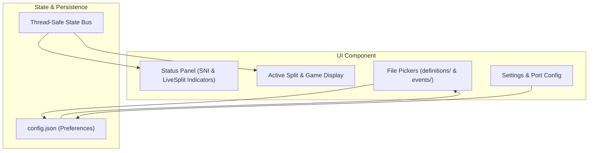

# UI & User Configuration Skill (`@ui-agent`)

This skill defines the technical standards, UI widget layout, state synchronization, and configuration persistence for the **User Interface & Settings** component of GotoSplitter, owned by `@ui-agent`.

---

## 1. Role & Architectural Boundaries

- **Owning Agent:** `@ui-agent`
- **Primary Packages:** `ui/`, `config/`
- **Key Files:** `ui/app.go`, `ui/status.go`, `ui/pickers.go`, `config/config.go`
- **Core Mission:** Provide a clean, responsive graphical UI (Fyne desktop or embedded local web dashboard) and manage persistent user preferences across restarts.

---

## 2. Core Responsibilities

1. **Connection Status Panel**:
   - Real-time indicator of **QUsb2Snes / SNI Status**:
     - `Disconnected` (Red)
     - `Connecting...` (Yellow)
     - `Attached to: <DeviceName>` (Green)
   - Real-time indicator of **LiveSplit One Client Status**:
     - `Waiting for LiveSplit One...` (Yellow)
     - `Connected (ws://localhost:16834)` (Green)

2. **Active Game & Split Monitor**:
   - Display currently active Game Name and Category.
   - Display current split target name being tracked by the event engine.
   - Show trigger feedback / split counter.

3. **Definition & Events File Pickers**:
   - Definition File Selector: Auto-discover JSON files in `definitions/`, provide dropdown selection, and allow manual browse.
   - Events File Selector: Auto-discover JSON files in `events/`, provide dropdown selection, and allow manual browse.
   - Notify `@coordinator` / `@event-engine-agent` whenever a new file is selected.

4. **Configuration Persistence (`config.json`)**:
   - Automatically save and reload user preferences:
     - `last_definition_file`
     - `last_event_file`
     - `sni_address` (default `localhost:8080`)
     - `livesplit_address` (default `localhost:16834`)
     - `target_device` (preferred SNES hardware/emulator)

5. **Non-Blocking UI Invariant**:
   > [!IMPORTANT]
   > The UI event loop (Fyne run loop or web server) MUST NEVER block on network I/O, SNI memory queries, or WebSocket handshakes.
   > **Implementation Rule:** All subsystem communication must be asynchronous via buffered channels or mutex-guarded state structs.

6. **Headless / CLI Fallback Mode**:
   - If a graphical display server (X11, Wayland, macOS Quartz) is unavailable (e.g. running on a headless server, Docker container, or CI), gracefully fallback to a clean CLI/terminal logger mode without crashing.

---

## 3. UI Specifications & Layout

See widget layout specifications in [references/ui_spec.md](./references/ui_spec.md).
See reference UI binding code in [examples/ui_example.go](./examples/ui_example.go).

---

## 4. Step-by-Step Implementation Runbook

1. **Check Display Availability**:
   - If running headless or flag `-headless` is passed, start CLI logger instead of Fyne window.
2. **Initialize Configuration**:
   - Call `config.Load()` to retrieve last-used files and network addresses.
3. **Build Window Layout**:
   - Top: Status badges (SNI status, LiveSplit status).
   - Middle: Current Game, Category, and Target Split label.
   - Bottom: File pickers (Dropdowns + Browse buttons) and Port inputs.
4. **Subscribe to State Updates**:
   - In a background goroutine, listen for status changes from the coordinator and update UI elements using `fyne.Do()` or channel ticks to ensure UI-thread safety.
5. **Persist Settings on Change**:
   - Whenever the user selects a new definition or events file, update `Config` and call `config.Save(cfg)`.

---

## 5. Verification & Validation Checklist

- [ ] Window renders smoothly without UI freezes when connecting or disconnecting from SNI.
- [ ] Status indicators update in real time when LiveSplit One connects or disconnects.
- [ ] Selected definition file persists to `config.json` and reloads on app restart.
- [ ] App starts in headless mode with `-headless` or when display is missing without panic.
