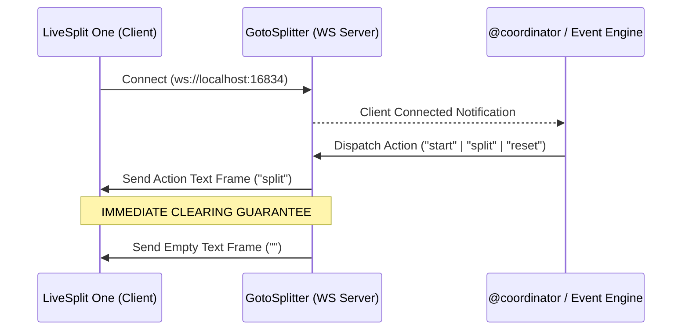

# LiveSplit One WebSocket Server Skill (`@livesplit-agent`)

This skill defines the technical standards, protocol implementation, and operational responsibilities for the **LiveSplit One WebSocket Server** component of GotoSplitter, owned by `@livesplit-agent`.

---

## 1. Role & Architectural Boundaries

- **Owning Agent:** `@livesplit-agent`
- **Primary Package:** `livesplit/`
- **Key Files:** `livesplit/server.go`, `livesplit/actions.go`, `livesplit/metadata.go`
- **System Role:** GotoSplitter acts as the **WebSocket Server**; the LiveSplit One web or desktop client (`https://one.livesplit.org/`) connects to GotoSplitter as a **Client**.



---

## 2. Core Responsibilities

1. **Host WebSocket Server**:
   - Bind and listen on a configurable local port (default: `16834`, URL: `ws://localhost:16834`).
   - Configure HTTP upgrader with permissive CORS / Origin checking to allow connections originating from `https://one.livesplit.org` or local web instances.

2. **Track Connection Lifecycle**:
   - Safely register connected clients and unregister disconnected clients.
   - Maintain client count and broadcast connection status changes to `@coordinator` and `@ui-agent`.
   - Prevent blocking or panics when writing to closed sockets.

3. **Dispatch Timer Actions**:
   - Supported standard commands:
     - `"start"`: Start the run timer.
     - `"split"`: Trigger current split and advance to the next.
     - `"reset"`: Reset timer to zero.
     - `"pause"`: Pause the running timer.
     - `"resume"`: Resume paused timer.
     - `"undo"`: Undo previous split.
     - `"skip"`: Skip current split without timing.

4. **Mandatory Immediate Action Clearing Guarantee**:
   > [!IMPORTANT]
   > LiveSplit One samples the incoming action state. If an action like `"split"` remains in the buffer or state, LiveSplit One may register duplicate split triggers on consecutive ticks.
   > **Implementation Rule:** Immediately after broadcasting an action (e.g. `"split"`), the server MUST broadcast an empty string `""` or no-op reset frame to clear the trigger state.

5. **Query Run Metadata**:
   - When supported by the client protocol (or requested via JSON/text queries), extract:
     - Game Name: Used by `@event-engine-agent` to auto-load definitions.
     - Category Name: Used by `@event-engine-agent` to match ordered events (`events.json`).
     - Current Split Name: Used for dynamic split matching (Path A).

---

## 3. Protocol & Implementation Details

See detailed packet specs in [references/protocol.md](./references/protocol.md).
See reference server implementation in [examples/server.go](./examples/server.go).

### Server Configuration
- **Address:** `localhost:16834` (configurable via `config.Config.LiveSplitAddress`)
- **Transport:** WebSocket (RFC 6455)
- **Message Types:**
  - Timer commands dispatched as standard Text frames (`websocket.TextMessage`).
  - Metadata queries/responses parsed as JSON or plaintext commands.

### Thread Safety & Buffer Guidelines
- Use a thread-safe hub pattern with mutex or dedicated write channels for each connected client.
- Outgoing message channels per client should be buffered (e.g., buffer size `16` or `32`) to prevent a slow consumer from blocking the autosplitter polling engine.
- Drop stale frames or disconnect slow clients if buffers overflow.

---

## 4. Step-by-Step Implementation Runbook

1. **Initialize the Server**:
   - Create `Server` struct with `sync.RWMutex`, client map `map[*Client]bool`, broadcast channel, and status callbacks.
2. **Setup HTTP Handler & Upgrader**:
   ```go
   var upgrader = websocket.Upgrader{
       CheckOrigin: func(r *http.Request) bool { return true }, // Allow LiveSplit One web
   }
   ```
3. **Handle Incoming Connections (`ServeHTTP`)**:
   - Upgrade HTTP request to WebSocket.
   - Register client in active clients registry.
   - Spawn write pump and read pump goroutines.
4. **Implement Action Broadcast with Immediate Clearing**:
   ```go
   func (s *Server) BroadcastAction(action string) {
       s.mu.Lock()
       defer s.mu.Unlock()
       // 1. Broadcast the action
       s.broadcast(action)
       // 2. Immediately clear
       s.broadcast("")
   }
   ```
5. **Handle Graceful Disconnect**:
   - Close client write channels, remove from registry, notify coordinator of client disconnection.

---

## 5. Verification & Validation Checklist

- [ ] LiveSplit One (`https://one.livesplit.org/`) can connect to `ws://localhost:16834` without CORS errors.
- [ ] Dispatching `"start"` starts the timer in LiveSplit One.
- [ ] Dispatching `"split"` triggers exactly **one** split. Verify no double-split occurs due to un-cleared state.
- [ ] Closing the browser tab disconnects cleanly without crashing GotoSplitter or deadlocking the server.
- [ ] Reconnecting LiveSplit One restores action dispatching immediately.
- [ ] Automated tests in `@qa-agent` pass using mock LiveSplit client.
