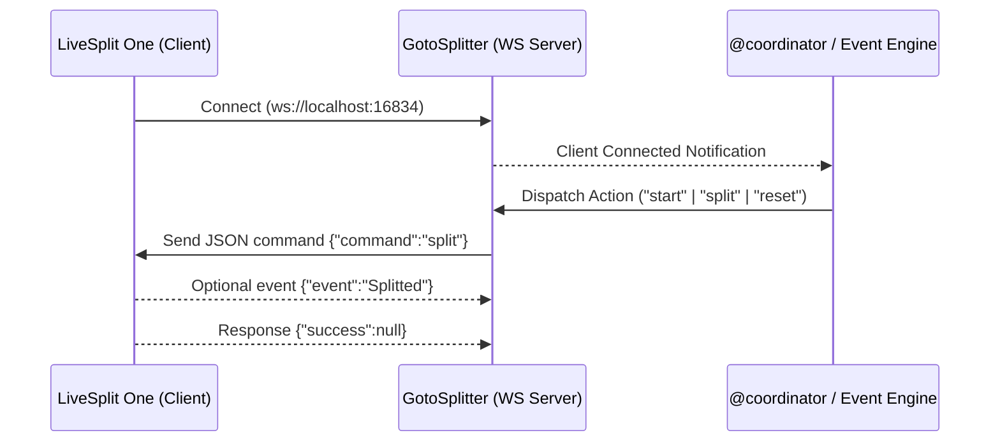

# LiveSplit One WebSocket Server Skill (`@livesplit-agent`)

This skill defines the technical standards, protocol implementation, and operational responsibilities for the **LiveSplit One WebSocket Server** component of GotoSplitter, owned by `@livesplit-agent`.

---

## 1. Role & Architectural Boundaries

- **Owning Agent:** `@livesplit-agent`
- **Primary Package:** `livesplit/`
- **Key Files:** `livesplit/server.go`, `livesplit/client.go`, `livesplit/protocol.go`
- **System Role:** GotoSplitter acts as the **WebSocket Server**; the LiveSplit One web or desktop client (`https://one.livesplit.org/`) connects to GotoSplitter as a **Client**.



---

## 2. Core Responsibilities

1. **Host WebSocket Server**:
   - Bind and listen on a configurable local port (default: `16834`, URL: `ws://localhost:16834`).
   - Configure HTTP upgrader with permissive CORS / Origin checking to allow connections originating from `https://one.livesplit.org` or local web instances.

2. **Track Connection Lifecycle**:
   - Safely register connected clients and unregister disconnected clients.
   - Maintain client count and broadcast connection status changes to `@coordinator` and `@ui-agent`.
   - Prevent blocking or panics when writing to closed sockets.

3. **Dispatch Timer Actions**:
   - Send text frames containing JSON commands with lower-camel-case `command` values, such as `{"command":"start"}`, `{"command":"split"}`, and `{"command":"pause"}`.
   - A reset must include the user's attempt-history choice: `{"command":"reset","saveAttempt":true|false}`.
   - Do not send bare action strings or empty "clear" frames; each command is a request with its own response.

4. **Handle Responses and Events**:
   - A success is wrapped in `{"success": ...}`; a failure is wrapped in `{"error": ...}`.
   - Timer events use `{"event": ...}` and may arrive before the corresponding success response. Do not consume an event as a command response.
   - Serialize requests per connection because the protocol has no request IDs.

5. **Query Timer State**:
   - Use `getCurrentState` for the phase and active segment index, then `getSegmentName` for the segment's name.
   - The protocol does not expose game or category metadata. Keep game-definition selection explicit and do not invent metadata queries.

---

## 3. Protocol & Implementation Details

See detailed packet specs in [references/protocol.md](./references/protocol.md).
See reference server implementation in [examples/server.go](./examples/server.go).

### Server Configuration
- **Address:** `localhost:16834` (configurable via `config.Config.LiveSplitAddress`)
- **Transport:** WebSocket (RFC 6455)
- **Message Types:**
  - Send commands as JSON in text frames (`websocket.TextMessage`).
  - Parse JSON success/error/event envelopes; raw text commands and raw split-name replies are not part of this protocol.

### Thread Safety & Buffer Guidelines
- Use a thread-safe hub pattern with mutex or dedicated write channels for each connected client.
- Outgoing message channels per client should be buffered (e.g., buffer size `16` or `32`) to prevent a slow consumer from blocking the autosplitter polling engine.
- Drop stale frames or disconnect slow clients if buffers overflow.

---

## 4. Step-by-Step Implementation Runbook

1. **Initialize the Server**:
   - Create `Server` struct with `sync.RWMutex`, client map `map[*Client]bool`, broadcast channel, and status callbacks.
2. **Setup HTTP Handler & Upgrader**:
   ```go
   var upgrader = websocket.Upgrader{
       CheckOrigin: func(r *http.Request) bool { return true }, // Allow LiveSplit One web
   }
   ```
3. **Handle Incoming Connections (`ServeHTTP`)**:
   - Upgrade HTTP request to WebSocket.
   - Register client in active clients registry.
   - Spawn write pump and read pump goroutines.
4. **Implement Action Dispatch and Response Handling**:
   ```go
   func (s *Server) DispatchAction(action string) error {
       // Encode {"command":"split"}, send it once, and await success/error.
       return s.dispatchCommand(protocolCommand{Command: action})
   }
   ```
5. **Handle Graceful Disconnect**:
   - Close client write channels, remove from registry, notify coordinator of client disconnection.

---

## 5. Verification & Validation Checklist

- [ ] LiveSplit One (`https://one.livesplit.org/`) can connect to `ws://localhost:16834` without CORS errors.
- [ ] Dispatching `"start"` sends a valid JSON command and handles its response.
- [ ] Dispatching `"split"` sends one command frame and handles a possible event followed by its response.
- [ ] Reset offers Save, Discard, and Cancel; Cancel sends no command.
- [ ] Current segment lookup uses `getCurrentState` and `getSegmentName`; game/category are not assumed to be available.
- [ ] Closing the browser tab disconnects cleanly without crashing GotoSplitter or deadlocking the server.
- [ ] Reconnecting LiveSplit One restores action dispatching immediately.
- [ ] Automated tests in `@qa-agent` pass using mock LiveSplit client.
