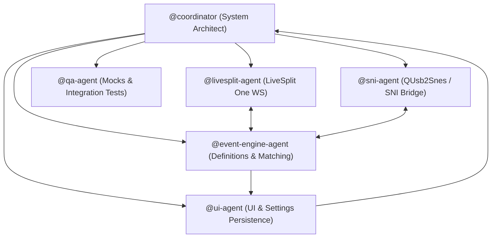

# AGENTS.md — GotoSplitter Multi-Agent Architecture & Guidelines

> **Project:** GotoSplitter  
> **Repository:** `github.com/chtpwner/GotoSplitter`  
> **Core Stack:** Go (Golang) 1.20+, WebSockets, Fyne / Web UI  
> **Target Systems:** QUsb2Snes / SNI (Super Nintendo Interface) & LiveSplit One (`https://one.livesplit.org/`)

---

## 1. Project Overview & Mission

**GotoSplitter** is a lightweight, cross-platform autosplitter written in Go. It acts as an intelligent intermediary bridge between a **QUsb2Snes / SNI** compatible device (real Super Nintendo hardware via SD2SNES / FXPAK Pro, or compatible emulators like RetroArch / Snes9x) and **LiveSplit One**.

### Core Operational Principles
1. **LiveSplit One WebSocket Server**: GotoSplitter hosts a WebSocket server that the LiveSplit One web/desktop client connects to as a client. GotoSplitter dispatches timer actions (`start`, `split`, `reset`, etc.) to LiveSplit One and immediately resets to an empty or no-op action once consumed to prevent repeated triggers.
2. **SNI / QUsb2Snes Client**: GotoSplitter connects by default to `ws://127.0.0.1:23074` (configurable via `GOTOSPLITTER_SNI_ADDRESS` or `$HOME/.config/gotosplitter/config.json`), enumerates devices (`DeviceList`), attaches to the active SNES hardware or emulator (`Attach`), and reads RAM (`GetAddress`).
3. **Definition-Driven Event Matching**: Compatible with the [ChTPwner/Usb2Snes-Livesplit-Definitions](https://github.com/ChTPwner/Usb2Snes-Livesplit-Definitions) specification. GotoSplitter identifies the game and current split, matches it against definition rules (such as `eq`, `bit`, `weq`, `more`, `next`), and reads memory.
4. **Optimized Ordered Polling**: To minimize overhead and eliminate unnecessary calls over the SNI socket, GotoSplitter monitors **only the memory address of the current active event**. If split names cannot be read dynamically from LiveSplit One, an ordered events file (`events.json`) mapped by game/category is used.
5. **User Interface & State Persistence**: A clear, responsive UI displays real-time connection statuses (SNI & LiveSplit One), allows manual selection of definition and event files when auto-detection is not possible, and saves user preferences across restarts.

---

## 2. Multi-Agent Roster & Specializations

To design, develop, and maintain GotoSplitter effectively, work is partitioned across specialized AI agents. Each agent operates with clear boundaries, package ownership, and interaction contracts.



### Agent Directory

| Agent Name | Role / Scope | Primary Packages / Files |
| :--- | :--- | :--- |
| `@coordinator` | System Architect & Orchestrator | `main.go`, `config/`, system lifecycle, concurrency channels |
| `@livesplit-agent` | LiveSplit One WebSocket Server | `livesplit/`, WS server, action dispatcher, query handler |
| `@sni-agent` | QUsb2Snes / SNI Client | `sni/`, device attachment, memory reader, reconnect loop |
| `@event-engine-agent` | Definitions, Parsing & Split Logic | `engine/`, `definitions/`, condition evaluator, sequential queue |
| `@ui-agent` | Graphical UI & Preference Store | `ui/`, `config/config.go`, file pickers, state monitors |
| `@qa-agent` | Mock Harnesses & Verification | `test/`, mock SNI server, mock LiveSplit client, unit/e2e tests |

---

## 3. Agent Specifications & Responsibilities

### 3.1 `@coordinator` (System Architecture & Pipeline Orchestrator)
- **Mission:** Maintain the high-level architecture, thread safety, and event loop synchronization between the LiveSplit server, SNI client, event engine, and UI.
- **Responsibilities:**
  - Define unified Go interfaces and channel-based message pipelines.
  - Manage non-blocking polling loops (`select`, `context.Context`, tickers).
  - Ensure graceful startup, reconnect, and teardown sequences.
- **Rules & Constraints:**
  - Never allow direct package-to-package circular dependencies (e.g. `sni` calling `livesplit` directly). All interactions flow through typed event channels or central coordinator interfaces.
  - Enforce atomic reads/writes or mutex protection on shared state.

### 3.2 `@livesplit-agent` (LiveSplit One WebSocket Server Specialist)
- **Mission:** Implement the WebSocket server listening for incoming connections from LiveSplit One (`https://one.livesplit.org/`).
- **Responsibilities:**
  - Listen on a configurable port (default `ws://localhost:16834` or configured in settings).
  - Track client connection lifecycle (Connected / Disconnected) and notify `@coordinator` / `@ui-agent`.
  - Send autosplitter actions (`start`, `split`, `reset`, `pause`, `resume`) to the client.
  - **Immediate Action Clearing:** As soon as the client receives or acknowledges an action, reset the active action state to empty string `""` or a no-op indicator so that duplicate triggers do not occur.
  - **Metadata Queries:** When supported by the client protocol, query the active run metadata:
    - Game Name (used to auto-select definition files).
    - Category Name (used to auto-select ordered events).
    - Current Split Name (used to identify active memory trigger).
- **Rules & Constraints:**
  - Handle client disconnects cleanly without crashing the polling loop.
  - Support both binary and text WebSocket frame types according to LiveSplit One specs.

### 3.3 `@sni-agent` (QUsb2Snes / SNI Bridge Specialist)
- **Mission:** Manage the low-level connection, device management, and memory reading from QUsb2Snes / SNI servers.
- **Responsibilities:**
  - Connect as a WebSocket client to `ws://127.0.0.1:23074` by default; `GOTOSPLITTER_SNI_ADDRESS` overrides the `sni_address` value in `$HOME/.config/gotosplitter/config.json`.
  - Implement the standard JSON opcode protocol:
    1. `DeviceList`: Discover connected SNES devices/emulators.
    2. `Attach`: Attach to the designated device (or auto-select the first available SNES device).
    3. `Name`: Set the client registration name (`GotoSplitter`).
    4. `GetAddress`: Request memory ranges `[AddressHex, SizeHex]` in `SNES` space.
  - Implement an auto-reconnect backoff loop if the SNI server drops or the emulator is closed/reopened.
  - Provide a clean Go API: `ReadMemory(address uint32, size int) ([]byte, error)`.
- **Rules & Constraints:**
  - Batch or rate-limit memory queries to avoid overwhelming the SNI connection (target ~15ms - 30ms polling interval).
  - Safely handle binary response payloads from QUsb2Snes.

### 3.4 `@event-engine-agent` (Definition Parser & Split Evaluator)
- **Mission:** Parse game definition files, manage ordered event queues, and determine when a split condition is met.
- **Responsibilities:**
  - Parse JSON definition files compatible with `Usb2Snes-Livesplit-Definitions`:
    - Root schema: `name`, `autostart`, `definitions`, `alias`, `igt`.
    - Rule objects: `name`, `address`, `value`, `type` (`eq`, `bit`, `weq`), `more` (concurrent conditions), `next` (sequential conditions).
  - **Active Split Tracking Strategy:**
    - *Path A (Dynamic):* If current split name is available from LiveSplit One, look up the corresponding definition in the active game definitions.
    - *Path B (Ordered Fallback):* If split names are not exposed by the client, load an ordered `events.json` file. Only poll the memory address for the **current step** in the sequence. Advance the pointer to the next event upon matching.
  - **Single-Address Monitoring:** At any given tick, only evaluate the memory condition of the current target split/event to minimize SNI bus load.
  - Emit typed actions (`ActionStart`, `ActionSplit`, `ActionReset`) to the `@coordinator`.
- **Rules & Constraints:**
  - Memory addresses in definitions are often strings in hex (e.g. `"0xF50010"`, `"0x7E0010"`, `"0xA0"`). Normalize all addresses to `uint32` using WRAM / SNES memory mapping standards.
  - Implement robust bitwise check logic (`bit`: test if bitmask is non-zero).

### 3.5 `@ui-agent` (UI & User Configuration Specialist)
- **Mission:** Provide a simple, responsive graphical user interface and manage configuration persistence.
- **Responsibilities:**
  - Render a lightweight window (e.g. using Fyne or an embedded lightweight local web dashboard):
    - **Status Panel:** Live indicator of QUsb2Snes/SNI status (Disconnected, Connecting, Attached to `<Device>`) and LiveSplit One client status (Waiting, Connected).
    - **Current Game & Split:** Display current detected game, active category, and split name being tracked.
    - **Definition File Picker:** Dropdown listing files from `definitions/`, with manual override.
    - **Events File Picker:** Dropdown listing files from `events/`, with manual override.
  - **Settings Persistence:**
    - Save and load settings to `$HOME/.config/gotosplitter/config.json` (last used definition file, last used events file, server ports, target device name).
- **Rules & Constraints:**
  - Keep UI interactions non-blocking; UI thread must never freeze when waiting on network or memory reads.
  - Fallback cleanly to CLI/headless mode if no display server is available.

### 3.6 `@qa-agent` (Test Harness & Verification Specialist)
- **Mission:** Ensure reliability, zero memory leaks, and protocol adherence without requiring physical hardware.
- **Responsibilities:**
  - Build a mock QUsb2Snes WebSocket server that can emulate memory responses for test games (e.g., Super Mario World, Zelda ALttP, Super Metroid).
  - Build a mock LiveSplit One WebSocket client that connects, reads actions, requests split updates, and verifies no-op transitions.
  - Unit test definition parsers against all sample JSON schemas in `ChTPwner/Usb2Snes-Livesplit-Definitions`.
  - Validate edge cases: rapid split transitions, dropped connections, emulator pause, and corrupted definition files.
- **Current Implementation Status:** 
  - ✅ Mock QUsb2Snes server with support for DeviceList, Attach, and GetAddress opcodes
  - ✅ Mock LiveSplit One client with message recording and immediate clearing verification
  - ✅ Basic test suite with compilation and execution
  - ✅ Definition parser test placeholders

---

## 4. Technical Specifications & Protocols

### 4.1 LiveSplit One WebSocket Protocol Specification
- **Role:** GotoSplitter is the **Server**; LiveSplit One is the **Client**.
- **Default Port:** `16834` (configurable, e.g. `ws://localhost:16834`).
- **Timer Action Messages:**
  - Standard commands: `"start"`, `"split"`, `"reset"`, `"pause"`, `"resume"`, `"undo"`, `"skip"`.
- **State Clearing Guarantee:**
  ```go
  // When an event triggers:
  server.BroadcastAction("split")
  
  // Immediately or after client consumption:
  server.BroadcastAction("") // Reset to no-op
  ```
- **Metadata Retrieval:** If LiveSplit One provides split names or queries, the server captures messages such as:
  - `getCurrentSplitName` / `getGameName` / `getCategoryName` or parses JSON payload packets according to `livesplit-core` WebSocket specifications.

### 4.2 QUsb2Snes / SNI Protocol Specification
- **Role:** GotoSplitter is the **Client**; QUsb2Snes / SNI is the **Server**.
- **Default Port:** `ws://127.0.0.1:23074` (configurable via `GOTOSPLITTER_SNI_ADDRESS` or `$HOME/.config/gotosplitter/config.json`).
- **Protocol Flow:**
  1. **Connect:** Open WebSocket connection.
  2. **Device Discovery:**
     ```json
     { "Opcode": "DeviceList", "Space": "SNES" }
     ```
     *Response:* `{"Results": ["SD2SNES COM3", "RetroArch"]}`
  3. **Attach Target:**
     ```json
     { "Opcode": "Attach", "Space": "SNES", "Operands": ["RetroArch"] }
     ```
  4. **Read Memory Block:**
     ```json
     { "Opcode": "GetAddress", "Space": "SNES", "Operands": ["F50010", "01"] }
     ```
     *Response:* Raw binary byte buffer or base64 data matching the requested size.

### 4.3 Definition File Specification (`Usb2Snes-Livesplit-Definitions`)
Definition files are JSON structures defining memory addresses and conditions:
```json
{
  "name": "Super Mario World",
  "autostart": {
    "name": "Start",
    "address": "0x7E0100",
    "value": "0x14",
    "type": "eq"
  },
  "definitions": [
    {
      "name": "Yoshi's Island 1",
      "address": "0x7E1F2E",
      "value": "0x01",
      "type": "bit"
    },
    {
      "name": "Bowser",
      "address": "0x7E0010",
      "value": "0x14",
      "type": "eq",
      "more": [
        {
          "address": "0x7E1DF5",
          "value": "0x10",
          "type": "eq"
        }
      ]
    }
  ]
}
```

#### Condition Evaluation Types
- `eq`: Evaluates whether `memory[address] == expected_value`.
- `weq`: Word equals (16-bit little-endian comparison).
- `bit`: Evaluates whether `(memory[address] & expected_value) != 0`.
- `more`: Slice of additional conditions that must ALL be true simultaneously.
- `next`: Slice of sequential steps that must occur in chronological order before the split fires.

### 4.4 Ordered Events Fallback Specification (`events.json`)
Used when LiveSplit One split names cannot be dynamically queried:
```json
{
  "game": "Super Mario World",
  "category": "11 Exit",
  "ordered_events": [
    {
      "event_name": "Start Run",
      "action": "start"
    },
    {
      "event_name": "Yoshi's Island 1",
      "action": "split"
    },
    {
      "event_name": "Yoshi's Island 2",
      "action": "split"
    },
    {
      "event_name": "Bowser",
      "action": "split"
    }
  ]
}
```
*Logic:* GotoSplitter resolves each `event_name` to its definition, listens **only** for the current event index, triggers the associated `action`, and increments the index pointer.

---

## 5. Development Guidelines & Coding Standards

1. **Idiomatic Go:** Follow standard Go style (`gofmt`, `go vet`). No unhandled errors.
2. **Concurrency Safety:**
   - Use `sync.RWMutex` for shared memory and state structures.
   - Use channels and `context.Context` for loop cancellation and inter-agent notifications.
3. **Resilience & Fault Tolerance:**
   - Always anticipate socket disconnects (SNES turned off, emulator closed, browser tab reloaded).
   - Polling loops must back off gracefully when disconnected rather than spinning at 100% CPU.
4. **Clean Project Structure:**
   ```text
   GotoSplitter/
   ├── AGENTS.md                 # Agent architecture & roles (this file)
   ├── main.go                   # Coordinator & entry point
   ├── config/                   # Config loading, saving, and defaults
   ├── livesplit/                # LiveSplit One WebSocket server implementation
   ├── sni/                      # QUsb2Snes / SNI client & memory querying
   ├── engine/                   # Definition parsers, matching logic, event sequencer
   ├── ui/                       # Fyne / desktop or web UI components
   ├── definitions/              # LiveSplit JSON definitions directory
   ├── events/                   # Ordered fallback events JSON directory
   └── test/                     # Mocks and automated integration tests
   ```

---

## 6. Agent Collaboration Workflow

When contributing or executing tasks:
1. **Identify the Owning Agent:** Check the table in Section 2. Tasks affecting WebSocket server logic belong to `@livesplit-agent`; memory queries belong to `@sni-agent`, etc.
2. **Review Interfaces:** Ensure changes adhere to the Go interfaces defined in `@coordinator`.
3. **Verify with `@qa-agent`:** Never merge or finalize a change without running the mock suite to ensure LiveSplit One and QUsb2Snes integration stays green.
